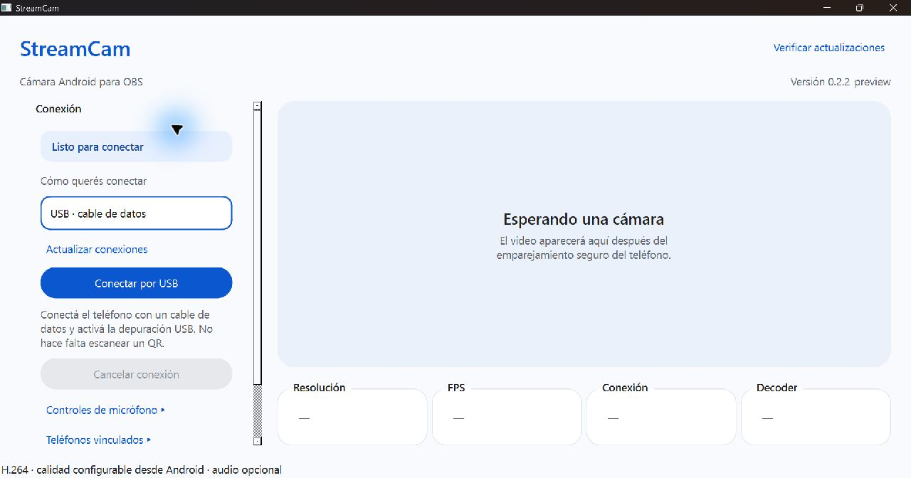
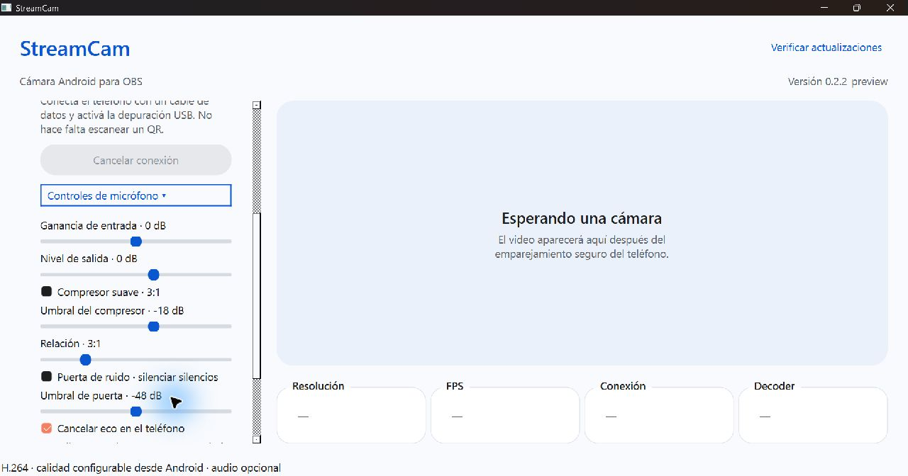

# StreamCam

Usá la cámara y el micrófono de tu teléfono Android en OBS Studio para Windows, por USB o por la red Wi-Fi local.

## Descargar StreamCam

### [⬇ Abrir descargas oficiales de StreamCam](https://github.com/julianzanutti/StreamCam/releases/tag/v0.3.16-preview)

En la página, abrí **Assets** y descargá el archivo que corresponde a cada equipo:

| Equipo | Descarga |
|---|---|
| Windows | [⬇ Descargar instalador de StreamCam](https://github.com/julianzanutti/StreamCam/releases/download/v0.3.16-preview/StreamCam-0.3.16-preview-windows-x64-setup.exe) |
| Android | [📱 Descargar APK de StreamCam](https://github.com/julianzanutti/StreamCam/releases/download/v0.3.16-preview/StreamCam-0.3.16-preview-android-preview.apk) |

**La publicación actual es StreamCam 0.3.16-preview.** El instalador de Windows termina en `windows-x64-setup.exe`; el archivo de Android termina en `android-preview.apk`. No elijas **Source code (zip)** ni **Source code (tar.gz)**: esos archivos son para inspeccionar el proyecto, no para instalarlo. La versión de Android no está en Play Store. Windows puede mostrar un aviso porque el instalador no tiene firma de editor; no desactives Play Protect ni Defender. Leé [los detalles de seguridad](SECURITY.md).

## Instrucciones

Seguí la [guía paso a paso](EMPEZAR.md): instalar en Windows y Android, conectar el teléfono por USB o Wi-Fi y agregar StreamCam a OBS. También podés consultar la [guía completa de instalación](docs/INSTALACION.md). La página de Releases incluye la licencia y los checksums opcionales.

## Capturas de pantalla

### Conectar el teléfono por USB o Wi-Fi

### Ajustar la voz

La segunda captura muestra los controles de voz incluidos en 0.3.16-preview. Su comportamiento con micrófonos físicos y distintos fabricantes sigue en validación.

## Qué incluye la versión pública

- Cámara frontal o trasera, con perfiles SD, HD y Full HD.
- Video H.264 por hardware y audio por USB o Wi-Fi.
- Conexión local autenticada. No usa cuentas ni comienza a transmitir antes de la confirmación visible.

La preview incluye ganancia, compresor, puerta de ruido, eco creativo y selección de entradas compatibles. Android y el fabricante deciden qué entradas de micrófono y funciones acústicas exponen; todavía falta validarlas con teléfonos y micrófonos reales. Consultá el [estado de pruebas](docs/V1_STATUS.md). Para usar el teléfono en Discord, seguí la [guía de micrófono de Windows](docs/AUDIO_VIRTUAL_WINDOWS.md).

## Código fuente (opcional)

Si solo querés usar StreamCam, ya tenés todo lo necesario en **Descargar StreamCam** y **Instrucciones**. Esta sección es para quienes quieran revisar o compilar el proyecto.

[Ver el código fuente](https://github.com/julianzanutti/StreamCam/tree/main) · [Descargar ZIP del código fuente](https://github.com/julianzanutti/StreamCam/archive/refs/heads/main.zip) · [Guía para compilar](BUILDING.md) · [Licencia GPL-3.0-or-later](LICENSE).
