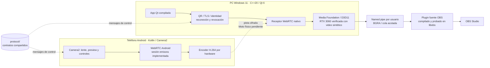
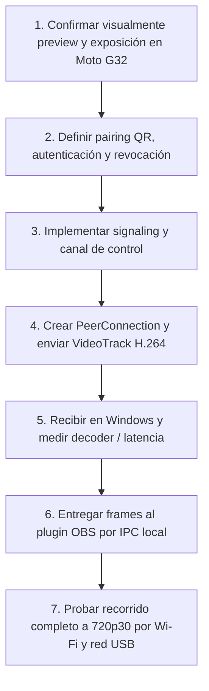

# Mapa del proyecto StreamCam

Actualizado: 2026-11-07

Este mapa explica qué es StreamCam, cómo se conectan sus módulos, qué está realmente implementado y dónde seguir. La meta es usar el Moto G32 como cámara para OBS en Windows 11 por Wi‑Fi o por red USB.

## Vista rápida

El recorrido sintético independiente WebRTC → decoder → pipe → fuente OBS pasó a720p:900 cuadros distintos en30,046s. La captura local del Moto ya fue probada en diagnóstico, pero el recorrido físico Moto → PC → OBS sigue pendiente. El encoder H264 de streaming pertenece a WebRTC: no se encadena el encoder del diagnóstico antes del encoder WebRTC.

## Estado por módulo

| Área | Ubicación | Estado actual | Función y límite |
|---|---|---|---|
| Android | `android/app/` | Diagnóstico y streaming compilados/instalados | Escáner QR, pin TLS, Keystore, PC guardada, emisor H264, controles iniciar/detener. Prueba de red física pendiente. |
| Protocolo | `protocol/` | Schema preliminar | Contrato JSON de control. No implementa pairing, serializador ni validador. |
| App Windows | `desktop/app/` | Compilada, ventana responde | QR/TLS, confirmación visible, identidades persistidas, reconexión firmada y revocación probadas con cliente independiente. |
| Media Windows | `desktop/media/` | Receptor probado con emisor sintético | WebRTC, decoder MF/D3D11 RTX3060 y salida BGRA RAM. |
| IPC | `desktop/ipc/` | Transferencia exacta probada | Named pipe restringido al usuario, tamaños limitados, timestamps y cierre seguro. |
| Plugin OBS | `obs-plugin/` | Compilado e instalado | Fuente async BGRA, IO cancelable; libobs recibió cuadros/píxeles correctos. UI OBS pendiente. |
| Documentación | `docs/` | En uso | Estado, mediciones, decisiones y este mapa. |

## Límites que debo respetar al trabajar

- La UI Android no debe convertirse en el lugar de sockets o transporte. La captura y sus capacidades pertenecen al módulo Android; pairing y signaling se agregan como capas explícitas.
- El video debe viajar por WebRTC cifrado solo después de pairing visible y autenticado. Wi‑Fi y red USB comparten ese transporte.
- `protocol/` es el contrato común del canal de control; validar comandos contra las capacidades Camera2 reales del dispositivo.
- La UI de Windows coordina el ciclo de vida, pero no decodifica ni procesa cuadros. `desktop/media/` separa transporte y decode.
- OBS se integra mediante el IPC local de `desktop/ipc/`; el plugin no debe alojar red/decoder. No afirmar zero-copy sin medir.
- No añadir audio, grabación, permisos o transmisión a la app de diagnóstico sin un flujo diseñado, visible y documentado.
- No confundir capacidades anunciadas por el teléfono con rendimiento medido, ni el APK de diagnóstico con la v1 integrada.

## Camino de extremo a extremo

El siguiente paso concreto requiere el Moto: escanear QR, confirmar identidad, iniciar video y comprobar Windows/OBS; luego repetir por tethering USB con Wi-Fi/datos móviles apagados y verificar ruta real. Ver `PRUEBA_INTEGRACION.md`. Todavía faltan mediciones físicas de latencia, carga y estabilidad prolongadas.

## Guía para orientarme en el repositorio

1. Empezar por `README.md` y `PROJECT_CONTEXT.md` para conocer objetivo, decisiones y sesión anterior.
2. Consultar `docs/V1_STATUS.md` para separar entregado de pendiente y ver el criterio de v1.
3. Leer el README del módulo que se vaya a tocar. Leer `PLAN_CAMARA_STREAM.md` para el razonamiento de arquitectura, pairing, seguridad y aceptación.
4. Mantener `PROJECT_CONTEXT.md` y `docs/V1_STATUS.md` actualizados cuando cambie el estado verificable.

## Mapa de archivos clave

- `README.md`: descripción corta, APK actual y estructura.
- `PROJECT_CONTEXT.md`: memoria breve para retomar trabajo y próximos pasos.
- `PLAN_CAMARA_STREAM.md`: diseño, riesgos y criterios de aceptación completos.
- `docs/V1_STATUS.md`: estado de la entrega integrada.
- `docs/MOTO_G32_DIAGNOSTICO_2026-11-06.md`: observaciones y mediciones del dispositivo.
- `android/app/src/main/java/com/streamcam/diagnostics/MainActivity.kt`: pantalla y diagnóstico Camera2 actual.
- `protocol/control-v1.schema.json`: contrato preliminar de control.
- `protocol/pairing-v1.md`: contrato preliminar del QR y casos de aceptación; no es una implementación.
- `desktop/app/`: interfaz/ciclo de vida de Windows.
- `desktop/media/`: futuro receptor WebRTC y decoder.
- `desktop/ipc/`: futuro puente local al plugin OBS.
- `obs-plugin/`: futura fuente OBS.
- `docs/decisions/`: decisiones de arquitectura con contexto y consecuencias.
