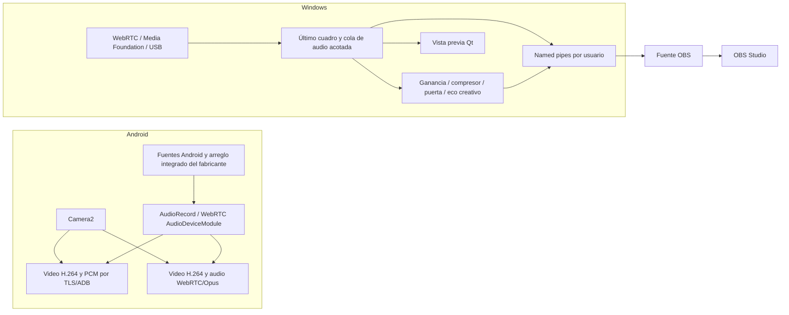

# Mapa del proyecto StreamCam

Actualizado: 2026-11-08. Paquete local integrado V2:

StreamCam envía la cámara y el micrófono de Android a OBS Studio en Windows, por USB/ADB o Wi‑Fi local. La captura empieza por acción visible del usuario; no hay grabación ni servidor externo de medios.

## Recorrido de medios

Android administra el arreglo integrado que expone cada fabricante; StreamCam no selecciona cápsulas físicas que Android no anuncie como entradas separadas. Cuando el sistema expone varias entradas, la app permite elegir una detectada y distingue nombres repetidos mediante el ID actual del dispositivo. AEC, supresión del sistema y AGC dependen del soporte de Android/OEM. La selección se fija al iniciar la captura.

La ruta USB agrupa lecturas parciales de AudioRecord a bloques mono PCM16 de 20 ms; admite fuentes de 8–48 kHz y remuestrea a 48 kHz con encabezado SCA1 de 32 bytes. Wi‑Fi usa Opus. Windows aplica ganancia, compresor, puerta y eco creativo opcional antes de OBS para ambas rutas. La puerta no es reducción espectral de ruido. La cancelación acústica ocurre en Android porque necesita la referencia de reproducción del sistema; no es el eco creativo.

## Estado por módulo

| Área | Ubicación | Estado V2 local | Límite pendiente |
|---|---|---|---|
| App Android | `android/app/` | Modos solo video, solo audio y ambos; selector de fuente/entrada con ID runtime y refresco automático; inventario de cápsulas/grupos Android y reporte activo visible junto a FPS/bitrate en USB; ajustes AEC/NS/AGC; captura PCM USB y ADM WebRTC Wi‑Fi | Validar en varios teléfonos; Android/HAL decide combinación del arreglo integrado y no todos exponen selección por cápsula |
| Receptor Windows | `desktop/media/` | WebRTC; decoder USB en worker dedicado, cola H.264 acotada con recuperación IDR; audio FIFO de hasta 100 paquetes | Prueba integrada de decoder/audio físico, presión y continuidad |
| Controles de voz | `desktop/media/VoiceProcessor.h`, `desktop/app/main.cpp` | Ganancia de entrada/salida, compresor, puerta y eco creativo de demora/retroalimentación/mezcla; valores guardados | Escucha, ajuste perceptual, latencia auditiva y rendimiento con sesiones largas |
| App Windows | `desktop/app/` | Qt, USB/ADB, Wi‑Fi, vinculación, vista previa, controles de voz y worker de decode USB independiente | Verificar sesión OBS real con preview minimizada y duración larga |
| IPC | `desktop/ipc/` | Pipes locales restringidos al usuario; worker de publicación para audio PCM y video BGRA | Medir consumidores lentos y validar reinicio de conexión en OBS |
| Fuente OBS | `obs-plugin/` | Plugin compilado contra OBS instalado; IO cancelable; mapeo monotónico para sesiones largas y reinicios de timestamp | Prueba de audio/video simultáneo, sincronía y sesión prolongada real |
| Contrato de control | `protocol/` | Control v1 directo y negociación optativa v2 para ACK de `audio.effects`, con fallback a clientes antiguos | Pruebas mixtas de versiones, ACK perdido y solicitudes duplicadas |
| Distribución | `README.md`, `EMPEZAR.md`, `desktop/package-v2-local.ps1`, `scripts/check-installer.ps1` | Integrado y verificado localmente en `dist/StreamCam-v2-0.3.11-preview` y `dist/v2-0.3.11-preview`; `--check-install`, 705 hashes del paquete y cuatro hashes de artefactos aprobados; smoke 0.3.11 aislado pasa instalación/reinstalación, AllSigned y desinstalación | No se publicó V2; firma de producción, QA física y compatibilidad siguen pendientes |

## Evidencia local reciente

- `assembleDebug lintDebug`: aprobados en Android.
- `StreamCamDesktop`, probes C++ y DLL del plugin OBS: compilados; DLL integrada en el paquete 0.3.9 y coincidente por SHA-256 con el build recién compilado.
- `StreamCamVoiceProbe`: ganancia, compresión, puerta y dos repeticiones de eco acotadas pasan sobre paquetes sintéticos válidos.
- `StreamCamAudioQueueProbe`: límite, orden FIFO, overflow y drenado parcial pasan.
- CI ahora ejecuta también `testDebugUnitTest` en Android y el probe `AudioSignal` en Windows; suite local de probes aislados 10/10 con Qt en PATH.
- Las guías públicas ya describen los Assets reales de GitHub (instalador, APK, licencia y hashes); quité pasos de un ZIP portable que no se publica y sincronicé las copias del paquete 0.3.9.
- Smoke del instalador 0.3.9 pasó con AppId temporal separado: instalación, reinstalación, `--check-install`, ruta con espacios y entorno PATH mínimo con `AllSigned`; después se desinstaló y se quitó su carpeta/clave.
- `StreamCamObsTimestampProbe`: sesión superior a una hora, timestamp duplicado, regresión y salto discontinuo pasan.
- CTest de medios/seguridad: CTest Release del escritorio 10/10; suite CMake aislada 11/11, incluido `ControlWebSocket` TLS loopback. Plugin OBS y sus probes 2/2; `AvTimestampMapper` cubre offset A/V compartido, ocho horas y overflow. `desktop/check-stale-consent.py` pasa la carrera de autorización sobre WSS: consentimiento obsoleto rechazado y socket pendiente cerrado.
- Paquete integrado 0.3.6-preview: Windows y APK Android (versionCode 10); build/lint, 6 pruebas Android, desktop 8/8, OBS 2/2, probes aislados 9/9, `--check-install` y manifiestos aprobados.
- Paquete integrado 0.3.7-preview: Windows y APK Android (versionCode 11); desktop 8/8 incluyendo backlog FIFO, OBS 2/2, probes aislados 9/9, Android build/lint y 6 pruebas; `--check-install` y SHA-256 de 705 archivos más setup/APK verificados. APK debug, setup sin Authenticode; falta QA física y revisión visual del panel.
- Paquete integrado 0.3.8-preview: Windows y APK Android (versionCode 12); CTest escritorio 9/9, plugin OBS 2/2, Android build/lint y 6 pruebas, `--check-install`, 705 hashes del paquete y hashes de cuatro artefactos release. DLL OBS del paquete coincide con el build. APK debug, setup sin Authenticode y QA física pendiente.
- Paquete local integrado 0.3.11-preview: Windows y APK Android (versionCode 15); Android build/lint y 19 unitarias, CTest escritorio 10/10, probes aislados 11/11 y plugin OBS 2/2. `AudioOutputWorker` pasó cinco ejecuciones seguidas. `--check-install` y 705 hashes del paquete más cuatro hashes de artefactos de descarga aprobados. Incluye handshake simultáneo y validación de límites de control-v2 probados en Kotlin/C++; ControlWebSocket TLS loopback y la carrera de consentimiento WSS también pasan. Smoke del setup pasó dos instalaciones, `--check-install`, PATH mínimo/AllSigned, desinstalación y limpieza. Android 35 AVD limpio abre la app; APK debug, setup sin Authenticode, no publicado; QA física pendiente.
- Paquete local integrado 0.3.9-preview: Windows y APK Android (versionCode 13); build/lint y 13 unitarias Android, CTest escritorio 9/9, CMake aislado 10/10 y plugin OBS 2/2. Setup reconstruido desde el paquete vigente; instalación, reinstalación aislada y `--check-install` aprobados. Se verifican 705 hashes del paquete y cuatro hashes de descarga. Incluye el handshake simultáneo control-v2 probado unitariamente. APK debug, setup sin Authenticode, no publicado; QA física pendiente.
- Instalador 0.3.1-preview: setup y APK versionados, hashes coincidentes y `--check-install` aprobado. El smoke de instalación no corrió porque existe una clave del mismo AppId cuyos valores no son legibles en este contexto. APK debug y setup sin Authenticode; artefactos de trabajo, no releases estables.
- Decodificación H.264 USB SD/HD/Full HD y pruebas sintéticas de autenticación/video constan en `docs/V1_STATUS.md`; no sustituyen QA físico de V2.

No hay un Android conectado para instalar y validar el APK actual. La salida local sigue separada de la preview pública. No anunciar compatibilidad general ni distribución V2 a partir de compilaciones/probes sintéticos.

## Arquitectura y prioridad

La UI coordina conexión y preview; `desktop/media/` mantiene recepción y decodificación. Workers independientes drenan audio y publican audio/video por los pipes locales, con probes que bloquean la UI mientras verifican la salida sintética. Aún falta demostrar continuidad con OBS real, preview apagada y varias horas.

Prioridad siguiente: validar SC‑011 con clientes de versiones mixtas; revisión visual de la barra de estado; medir sincronía A/V y completar matriz física USB/Wi‑Fi, decoder, modos y micrófonos. El plan con criterios y puertas está en `docs/V2_DEVELOPMENT_PLAN.md`; el estado detallado de evidencia está en `docs/V1_STATUS.md`.

## Archivos para orientarse

- `README.md`: instalación sencilla para usuarios y descargas públicas.
- `EMPEZAR.md`, `docs/INSTALACION.md`: configuración de Windows, Android y OBS.
- `docs/V1_STATUS.md`: comprobaciones, pendientes y dispositivos físicos.
- `docs/V2_DEVELOPMENT_PLAN.md`: alcance, backlog y aceptación de V2.
- `protocol/control-v1.schema.json`, `protocol/control-v2.schema.json`: objetos directos del wire autenticado y negociación optativa de controles V2.
- `BUILDING.md`, `android/README.md`, `desktop/README.md`: compilación y empaquetado.
- `PROJECT_CONTEXT.md`: archivo local ignorado por Git, sirve como memoria de desarrollo y no como documentación pública.

- Build de trabajo Android 0.3.10: assembleDebug/lintDebug y 19 unitarias; el APK de trabajo incluye la ruta Bluetooth revisada y no es el APK conservado dentro del paquete local firmado con el certificado previo. Desktop probes aislados 11/11 (incluida entrega/medidor/reconexión de AudioOutputWorker), desktop CTest 10/10 y plugin OBS 2/2. AudioOutputWorker pasó cinco ejecuciones seguidas. `ControlWebSocket` TLS y `check-stale-consent.py` pasan con sockets loopback habilitados. Paquete Windows generado con `--check-install`; manifiestos con 705 archivos y cuatro artefactos de descarga verificados. Smoke del instalador aislado pasó dos instalaciones, `--check-install`, PATH mínimo/AllSigned, desinstalación y ausencia de clave/archivos residuales; el log quedó bajo `.tooling`. QA física Android↔Windows pendiente.
