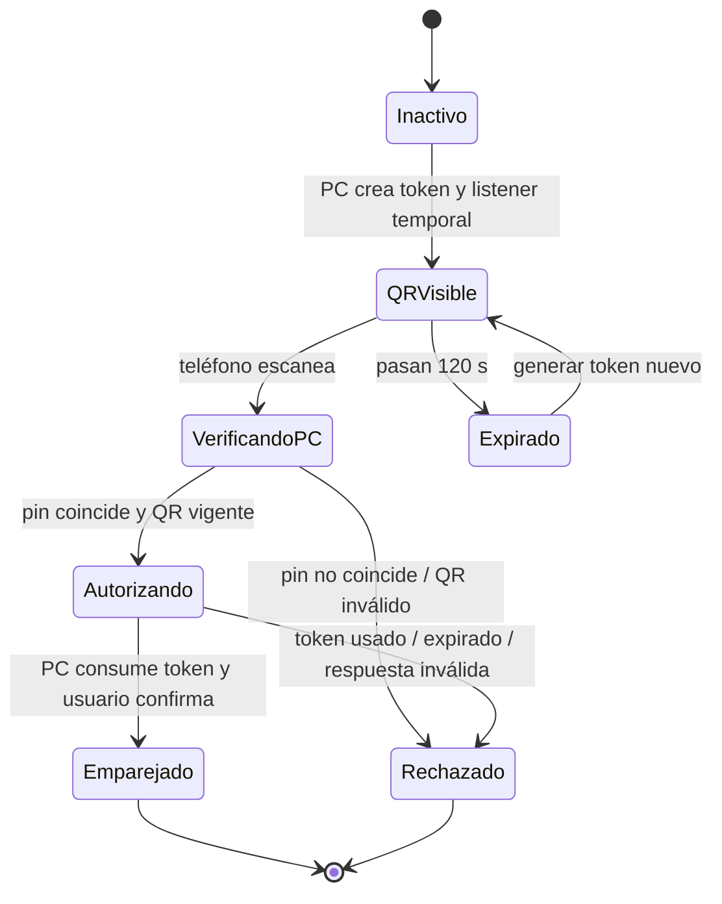

# Pairing QR v1

Estado: implementado y probado con cliente TLS independiente; falta escaneo/handshake físico en Moto. Listener temporal sobre IPv4 privada seleccionada, puerto47831. Identidad PC protegida con DPAPI; teléfono usa RSA2048 no exportable en Android Keystore.

## Identidad y reconexión implementadas

`pair.request` exige exactamente version=1,type,token,nonce,device_id,device_key,device_proof. device_key es SubjectPublicKeyInfo DER en base64; device_id es SHA256 hexadecimal de esa clave. device_proof es firma SHA256/RSA-PKCS1 sobre UTF8 `StreamCam pair v1\n<pc_id>\n<nonce>`. Verificar firma y estado no revocado antes de consumir token. Confirmación PC guarda la clave pública; no se guardan tokens QR.

La reconexión usa `reconnect.hello` (version,type,device_id), desafío aleatorio nuevo de32 bytes por conexión en `reconnect.challenge`, y `reconnect.proof` (version,type,device_id,device_proof) firmado sobre `StreamCam reconnect v1\n<pc_id>\n<challenge>`. El desafío se consume antes de verificar y no puede reutilizarse. Exige clave pública guardada no revocada y confirmación visible. Escucha habilitada por usuario y vencimiento120s; sesión autorizada mantiene solo su socket. Revocar cierra sesión y bloquea la identidad persistida.

## Propósito

El QR autoriza un intento de pairing entre esta instalación Windows y un teléfono. No contiene video, oferta SDP ni credenciales permanentes. Escanearlo no inicia la cámara ni transmite medios.

## Payload

Codificar un objeto JSON UTF-8 compacto con versión y campos cerrados:

```json
{
  "version": 1,
  "endpoint": "wss://192.168.137.1:47831/pair",
  "pc_id": "<id-aleatorio-estable>",
  "pc_key_sha256": "<64 caracteres hex minúsculos>",
  "token": "<32 bytes aleatorios, base64url sin padding>",
  "expires_at": "<fecha UTC ISO-8601>",
  "nonce": "<16 bytes aleatorios, base64url sin padding>"
}
```

El endpoint debe corresponder al listener activo en la interfaz elegida. Se usa `wss` con un certificado cuya clave pública corresponde al pin `pc_key_sha256`. La app verifica primero el pin y solo entonces presenta el token al endpoint. No se acepta un certificado inesperado para continuar.

El token debe tener al menos 256 bits de entropía, ser de un solo uso y expirar en 120 segundos. La PC lo invalida atómicamente en el primer intento autenticado válido; reintentos requieren un QR nuevo. `nonce` evita colisiones y se vincula a esa sesión de pairing. El reloj vencido o no confiable debe producir un fallo explícito y permitir regenerar QR.

## Máquina de estados y pruebas



Casos mínimos para probar el contrato antes del transporte real:

1. Payload válido, versión conocida, endpoint local, pin, token y vencimiento futuro → aceptar como invitación, sin arrancar cámara.
2. Pin distinto → rechazar antes de revelar/enviar el token.
3. Token expirado, ya consumido, de longitud/alfabeto incorrecto o nonce inválido → rechazar.
4. Versión desconocida, propiedad extra, URL no local, `http://`, credenciales dentro de URL o tamaño mayor a 2048 bytes → rechazar.
5. Cancelar/expirar pairing → invalidar token y cerrar listener temporal.
6. Confirmación en teléfono y PC → guardar identidad por dispositivo; habilitar medios solo por acción explícita posterior del usuario.

## Restricciones de implementación

- El endpoint debe pertenecer a una interfaz elegida por el usuario (Wi-Fi o tethering USB); no hacer bind general a todas las interfaces.
- QR dinámico, mostrar nombre/identidad de PC y cuenta regresiva; botón Cancelar invalida token y listener.
- Nunca escribir token, URL completa ni QR a logs, analítica, clipboard o archivos.
- Proteger clave privada persistente de PC con DPAPI; en Android guardar la identidad emparejada con Android Keystore.
- El token autoriza solo el handshake de pairing; no sustituye TLS autenticado ni DTLS-SRTP de WebRTC.
- No agregar permisos de cámara/red ni conectividad al APK de diagnóstico como parte de un mock de QR. La implementación integrada se hará en un módulo y flujo separados.

## Qué se puede probar ahora

El listener, escáner, verificación de identidad y sesión están implementados. Las pruebas independientes de QR y TLS/firmas/revocación pasaron; el recorrido físico Moto→Windows sigue pendiente. Consultar `../docs/V1_ACCEPTANCE_AUDIT.md` para la evidencia de cada requisito.
